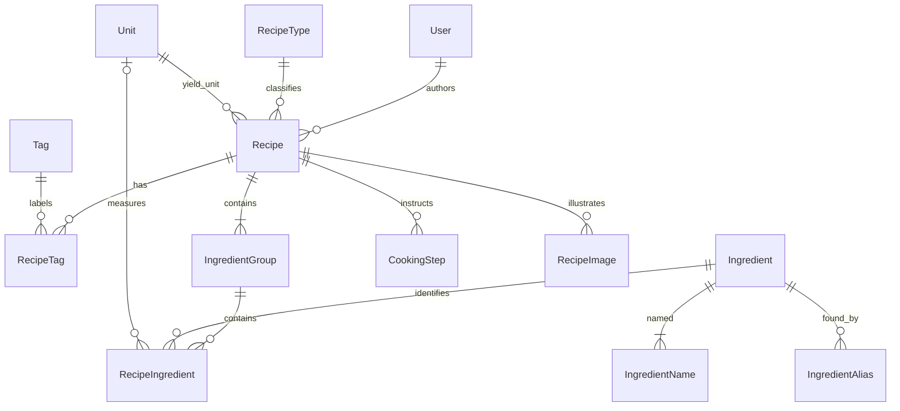

# Recipe 0.1 domain model

This document records the model approved before implementation, including the subsequent quantity-range and tag-filter revisions. The model prioritizes real recipe entry over speculative infrastructure. Version 0.1 may be discarded or substantially redesigned after evaluation.

## Relationships



## Recipe and ownership

A recipe has a stable GUID, one author, one data-backed recipe type, name, optional description, yield, optional total time in positive whole minutes, tags, ingredient groups, steps, images, UTC creation/update timestamps and a Draft/Published state. Name is required and limited to 200 characters.

The seeded local user is an administrator and is resolved server-side through `ICurrentUser`; requests cannot choose an author or role. Catalogue writes check administrator status. There is no login in this local prototype. Changing the current-user implementation alone does not constitute complete multi-user security; authentication, ownership policies and public visibility must be designed before deployment.

Drafts require a name, type and numeric yield. They may lack ingredients/steps. Published recipes additionally require at least one ingredient and one nonblank cooking step. Publishing is a local state change, not public distribution. The recipe editor has an explicit save operation; no autosave or recipe deletion is implemented.

## Quantities and yield

`Quantity` is a small immutable value object with nullable decimal `Value` and nullable decimal `MaximumValue`:

| Meaning | Value | MaximumValue |
|---|---:|---:|
| Exact | 2 | null |
| Fractional | 0.5 | null |
| Range | 2 | 3 |
| Unspecified | null | null |

Supplied values must be positive. A maximum requires a value and must be strictly greater; equal bounds are represented as an exact amount. Ranges are never relegated to notes. PostgreSQL stores amounts as unconstrained `numeric`; no fixed database scale silently rounds author input. The API uses JSON numbers, so the browser's normal JavaScript number precision applies. Extremely high precision is outside the intended culinary use cases.

A recipe ingredient stores Quantity, optional UnitId, optional AmountDescription, Preparation, Note and SortOrder. Numeric amounts require a unit suitable for ingredients. An unspecified quantity requires no unit and may have wording such as “to taste” in AmountDescription. This wording is not the structural representation of an unspecified quantity; the null numeric fields are. Preparation such as “finely chopped” belongs to the entry, not the canonical ingredient. AmountDescription may also qualify a numeric amount, for example “approximately”. This is prose only, not a conversion-accuracy model.

Yield reuses Quantity because exact and ranged values obey the same numeric rules. Its owning value object requires a value and a unit suitable for yield. Examples: 4 portions, 500 g, 1.5 litres, 20–24 pieces. Yield is stored on Recipe as YieldValue, YieldMaximumValue and YieldUnitId. Ingredient amounts use AmountValue/AmountMaximumValue on RecipeIngredient. Quantity and Yield do not have separate entity tables.

Domain validation and database checks reject invalid ranges, nonpositive amounts and inconsistent ingredient amount/unit combinations. Unit eligibility is validated by the application because it depends on catalogue data.

## Ingredients and catalogue names

Ingredient.Id is a language-independent canonical identity. IngredientName holds one preferred name per language; IngredientAlias holds additional names with optional language. Both name sets are searched case-insensitively using literal substring matching, including all stored languages. SQL wildcard characters in user input are escaped. An ambiguous alias may resolve to multiple ingredients; the author chooses. There is no global uniqueness requirement on ingredient names or aliases and no fuzzy matching.

Searchable name columns use an explicit deterministic ICU `und` collation. This keeps case-insensitive matching of Swedish letters consistent even when PostgreSQL is initialized with a host locale such as `C`. The PostgreSQL installation must include ICU (the supplied PostgreSQL 18 Docker image does).

Display fallback is requested language, Swedish, English, then another stored language. Catalogue search returns at most 50 matches; narrow the query when necessary. Recipe entry accepts existing ingredient IDs only and never silently creates ingredients. Repeated use of the same canonical ingredient in one recipe or group is valid.

Administrator maintenance supports creation and editing of canonical ingredients, preferred names/translations and aliases. There is no deletion, merging or request workflow in 0.1. Names and aliases are limited to 200 characters; language codes to 35. RecipeTypes, Tags and Units have stable IDs/codes and separate localized name records. Their maintenance is seed-driven in this iteration. RecipeType and Unit are data, not enums. UnitDimension and PublicationState are small enums because they describe application behavior, not editable classifications.

## Groups, steps and images

Every RecipeIngredient belongs to an IngredientGroup. A recipe always has at least one group; saving with no groups creates a default unnamed group. The detail UI hides headings for unnamed groups. Group, entry, step and image IDs remain stable across edits and ordering changes. Moving an entry between groups keeps its identity. Array order in write contracts determines normalized zero-based SortOrder; clients do not control persistent ordering numbers.

CookingStep contains ID, recipe ID, instruction and sort order. Durations, temperatures, timers, images and ingredient references are deferred.

RecipeImage contains ID, recipe ID, opaque storage key, content type, primary flag, optional caption and sort order. There may be zero or one primary images; the first upload becomes primary. Removing the primary does not automatically nominate another. A filtered unique database index enforces at most one primary per recipe. Primary switches are saved in a transaction that clears the previous database flag before updating the tracked rows. Images are uploaded after the first recipe save. The UI saves image metadata separately and warns about unsaved image metadata.

`IImageStorage` is the one storage boundary needed now to keep disk paths out of domain/application behavior. The local implementation uses generated filenames and disallows path traversal. Files are not stored in PostgreSQL. Failed database uploads attempt file cleanup; process crashes or failed file removal may leave orphan files. Cloud storage is not implemented.

## Search semantics

The approved initial semantics are:

```text
Name match
AND RecipeType
AND Ingredient A AND Ingredient B
AND (Tag A OR Tag B)
```

Empty categories do not constrain results. Selected IDs are deduplicated. Ingredient autocomplete resolves aliases to canonical IDs before recipe filtering. Ingredient filters match across all groups. Queries execute in PostgreSQL; results are paged (20 by default, maximum 100), sorted by last update then ID. Drafts and locally published recipes are both shown.

**Revisit ingredient AND and tag OR semantics after entering/searching real recipes.** No configurable query language or alternate operator mode is implemented yet.

## Persistence and API conventions

EF Core configuration lives in Infrastructure, separate from domain classes. Foreign keys protect referenced authors, ingredients, units, types and tags from deletion. Recipe-owned children use cascading deletion at the schema level, although recipe deletion is not exposed. RecipeTag uses a composite key and cannot contain duplicates. Recipe content updates use one SaveChanges transaction. Database migrations are explicit, not automatic on normal startup. Development seed data is separate from migrations and only runs against an empty user table.

The API exposes `/api/catalogue`, `/api/ingredients`, `/api/recipes`, `/api/me`, and recipe image endpoints. GET `/api/ingredients?query=...` searches preferred names and aliases. POST/PUT ingredient endpoints use `{ names: [{ language, name }], aliases: [{ language, name }] }`. Recipe search accepts name, recipeTypeId, repeated or comma-separated ingredientIds/tagIds, page, pageSize and language.

Recipe write contracts nest ingredients under groups and quantity under both ingredient and yield:

```json
{
  "yield": {
    "quantity": { "value": 20, "maximumValue": 24 },
    "unitId": "<piece-unit-id>"
  },
  "ingredientGroups": [{
    "heading": "Sauce",
    "ingredients": [{
      "ingredientId": "<canonical-ingredient-id>",
      "quantity": { "value": 2, "maximumValue": 3 },
      "unitId": "<decilitre-unit-id>",
      "amountDescription": null,
      "preparation": null,
      "note": null
    }]
  }]
}
```

This is a partial contract example. Recipe saves also supply name, recipeTypeId, publicationState, tagIds and cookingSteps, with optional description and totalTimeMinutes. For new children omit IDs; for existing children return their IDs. Foreign or duplicate child IDs are rejected. Missing existing children are removed; stable child identities are preserved for those retained. Read contracts include labels, sort order, timestamps and image URLs. Validation errors use Problem Details with field paths where available. Writes do not accept author identity or catalogue creation through recipe entries.

## Future translations and other deferred capabilities

Recipe prose is stored once, in the author's entered language, with no assumption that it is Swedish. **A future translation must be able to belong to the same Recipe identity**, rather than requiring one recipe per language. Stable IDs on Recipe, IngredientGroup, RecipeIngredient, CookingStep and RecipeImage provide attachment points for localized names, descriptions, headings, preparation, notes, amount descriptions, instructions and captions. Translated prose could later move to entity/language records without changing canonical ingredient references or numeric quantities.

No recipe translation tables, management UI, synchronization workflow or assumed cross-language editing policy exist yet. Whether translated recipes always share exactly the same steps and ingredient structure needs evaluation.

Preserved original amounts/units and dimensions permit future display conversions and scaling. Generic conversions and ingredient-specific conversions remain separate future concerns. The US cup has a distinct code; “tablespoon” and “teaspoon” seed entries explicitly identify their metric volumes. Dimension alone does not define conversion factors. Approximate conversions must eventually be distinguishable from exact ones. No conversion/scaling tables, base-unit values or engine are added. Scaling a range requires a future policy for the requested target and reference point.

Registration, OAuth, subscriptions, payments, comments, ratings, popularity, public recipe discovery, ingredient requests, advanced step features and cloud storage are not implemented.

## Questions to evaluate with real recipes

- Are ranges, unspecified amounts and AmountDescription sufficient for “one 400 g can”, divided amounts and mixed fractions?
- Is numeric yield required too early for drafts? Does draft/published completeness match actual entry habits?
- Does tag OR filtering give expected results alongside ingredient AND filtering?
- Is moving entries between groups and using keyboard autocomplete practical for long recipes?
- Are aliases ambiguous in useful ways, and when will catalogue merging or ingredient requests become necessary?
- Are seeded unit eligibility and explicit metric measures adequate for imported recipes?
- Is a separate image-save flow clear enough? Are resizing and thumbnails needed?
- Should TotalTime remain entered manually, and when are per-step duration and temperature needed?
- How should range scaling work, and what constitutes an exact versus approximate conversion?
- Should future recipe translations share identical ingredient/step structure, and how should edits invalidate translations?
