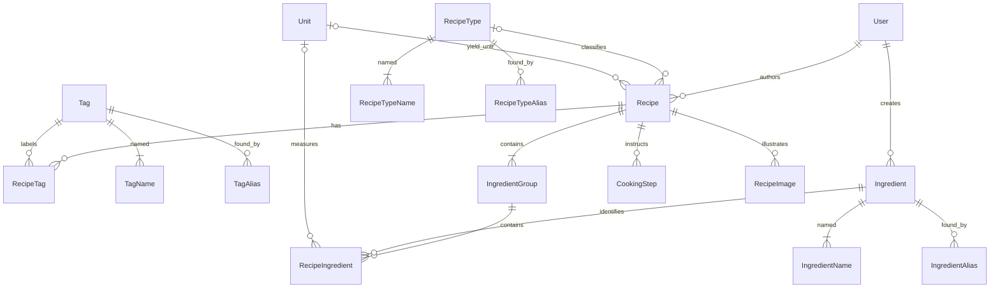

# Recipe 0.1 domain model

This document records the approved model and the 2026-09-26 changes following real-recipe testing: permissive drafts, ingredient lifecycle, inline creation and improved catalogue search. These changes supersede the original administrator-only creation and mandatory draft completeness requirements in SPECIFICATION.md. The model prioritizes real recipe entry over speculative infrastructure. Version 0.1 may be discarded or substantially redesigned after evaluation.

## Relationships



## Recipe and ownership

The approved activity-mode iteration (2026-09-27) is implemented as described in [PRODUCT_DECISIONS.md](PRODUCT_DECISIONS.md). Modes are activities, not account types. Hitta & laga is the default published-recipe list; Skapa & utforska contains the current user's own recipes/drafts and standalone ingredient creation; Administration groups the existing administrator catalogues. No authentication or moderation workflow is introduced.

A recipe has a stable GUID, one author, optional data-backed recipe type and yield, name, optional description, optional total time in positive whole minutes, tags, ingredient groups, steps, images, UTC creation/update timestamps and a Draft/Published state. An unnamed draft stores an empty name; the UI displays `Namnlöst recept` without persisting that placeholder. Names remain limited to 200 characters.

The seeded local user is an administrator and is resolved server-side through `ICurrentUser`; requests cannot choose an author, creator, ingredient status or role. All known authors may explicitly create ingredients. Editing existing catalogue entries and opening administrator catalogues require administrator status. Administrators may set Tag/RecipeType active state. There is no login in this local prototype. Changing the current-user implementation alone does not constitute complete multi-user security; authentication, ownership policies and public visibility must be designed before deployment.

Drafts may omit name, RecipeType and Yield and contain no ingredient entries or cooking steps. Entered data must still be structurally valid: known/visible references, positive quantities, ordered range bounds, consistent units and positive total time. An entirely absent yield is null; a supplied yield must be complete and valid, even on a draft. Empty step rows must be removed or given text rather than saved as instructions.

`Recipe.Validate` handles structural rules independently of `ValidatePublication`, which requires a nonblank trimmed name, RecipeType, valid Yield, at least one ingredient and one nonblank cooking step. Publishing is a local state change, not public distribution. The recipe editor saves explicitly, retains navigation/before-unload protection, and uses `Ger` as the Swedish label while Domain/API retain `Yield`.

## Quantities and yield

`Quantity` is a small immutable value object with nullable decimal `Value` and nullable decimal `MaximumValue`:

| Meaning | Value | MaximumValue |
|---|---:|---:|
| Exact | 2 | null |
| Fractional | 0.5 | null |
| Range | 2 | 3 |
| Unspecified | null | null |

Supplied values must be positive. A maximum requires a value and must be strictly greater; equal bounds are represented as an exact amount. Ranges are never relegated to notes. PostgreSQL stores amounts as unconstrained `numeric`; no fixed database scale silently rounds author input. The API uses JSON numbers, so the browser's normal JavaScript number precision applies. Extremely high precision is outside the intended culinary use cases.

A recipe ingredient stores Quantity, optional UnitId, optional AmountDescription, Preparation, Note and SortOrder. Numeric amounts require a unit suitable for ingredients. An unspecified quantity requires no unit and may have wording such as “to taste” in AmountDescription. This wording is not the structural representation of an unspecified quantity; the null numeric fields are. Preparation such as “finely chopped” belongs to the entry, not the canonical ingredient. AmountDescription may also qualify a numeric amount, for example “approximately”. This is prose only, not a conversion-accuracy model.

Yield reuses Quantity because exact and ranged values obey the same numeric rules. If present, its value object requires a value and a unit suitable for yield. Examples: 4 portions, 500 g, 1.5 litres, 20–24 pieces. Yield is stored on Recipe as nullable YieldValue, YieldMaximumValue and YieldUnitId. All three null means absent; otherwise value/unit must both exist and the optional maximum must exceed value. Ingredient amounts use AmountValue/AmountMaximumValue on RecipeIngredient. Quantity and Yield do not have separate entity tables.

Domain validation and database checks reject invalid ranges, nonpositive amounts and inconsistent ingredient amount/unit combinations. Unit eligibility is validated by the application because it depends on catalogue data.

## Ingredients and catalogue names

Ingredient.Id is a language-independent canonical identity. IngredientName holds one preferred name per language; IngredientAlias holds additional names with optional language. Both name sets are searched case-insensitively using literal substring matching, including all stored languages. SQL wildcard characters in user input are escaped. An ambiguous alias may resolve to multiple ingredients; the author chooses. There is no global uniqueness requirement on ingredient names or aliases and no fuzzy matching.

Searchable name columns use an explicit deterministic ICU `und` collation. This keeps case-insensitive matching of Swedish letters consistent even when PostgreSQL is initialized with a host locale such as `C`. The PostgreSQL installation must include ICU (the supplied PostgreSQL 18 Docker image does).

Display fallback is requested language, Swedish, English, then another stored language. Autocomplete trims input and executes no search below two Unicode code points; the UI also makes no request or displays results below that threshold. Results remain canonical ingredients, not names/aliases, and are ranked: exact preferred name, preferred-name prefix, alias prefix, preferred-name substring, alias substring. Ranking includes all translations. Display-name ordering and ID break ties; autocomplete returns at most 50 results after ranking. `cour` can therefore select Zucchini through courgette. Duplicate matching names/aliases do not duplicate an ingredient.

The previous one-character behavior came from `%query%` ILIKE matching across every translated name and alias, enabled for every nonempty input. In particular `R` matched Blomkål via English Cauliflower; the Swedish label obscured why it matched. There was no relevance ranking. Short-input gating now exists in both the UI and database-query entry point, and stale results are suppressed when the input changes.

Recipe writes still accept canonical ingredient IDs only, never silently converting free text into ingredients. With no autocomplete match, the author can explicitly choose `+ Skapa ”…”`. A modal collects a preferred name and language (Swedish initially), calls the same ingredient-creation service as the full catalogue, then selects the returned canonical ingredient in the current group. It does not save, navigate away from, or reset the recipe. Creation persists independently, so an ingredient can remain even if the recipe is later abandoned. Repeated use of the same canonical ingredient in a recipe is valid.

Administrator maintenance remains the full catalogue tool. It lists all ingredients by default (no autocomplete cap), sorted alphabetically by the preferred display name using the selected UI language's comparer. It searches names/translations and aliases, and offers Alla (default), Aktiv and Väntar på granskning filters. Pending entries are visibly labeled. Selecting an entry edits preferred names/translations and aliases; it does not approve or merge it. Catalogue search can use a single character; only autocomplete has the two-character minimum. Names/aliases remain limited to 200 characters and language codes to 35. RecipeTypes, Tags and Units retain stable IDs/codes and localized names; Units remain seed-managed, while Tags and RecipeTypes have administrator maintenance described below. RecipeType/Unit are data; UnitDimension, PublicationState and IngredientStatus describe application behavior as small enums.

### Ingredient lifecycle and visibility

Ingredient retains its canonical ID and adds `Status` (PendingReview or Active), `CreatedByUserId` (required User foreign key) and `CreatedAt` (UTC). `Ingredient.Create` assigns Active for an administrator and PendingReview otherwise. Neither creation path accepts these fields from the caller. Existing-entry edits remain administrator-only; self-editing pending names is not introduced in this iteration.

Active ingredients are selectable/searchable by all authors. PendingReview ingredients are selectable/searchable only by their creator, across any of that creator's recipes. Both autocomplete and recipe-save reference validation apply this rule at the query level. Direct ingredient reads by ordinary users also enforce it. The separate administrator catalogue and administrator detail/edit access intentionally allow inspection of all pending entries for curation; admin access does not add others' pending entries to recipe autocomplete or permit their selection in recipes.

As an initial privacy rule, recipe lists/details hide recipes containing another user's pending ingredients rather than exposing those ingredients through an editor. Creators can save these recipes and reuse their pending ingredients. Public visibility/moderation policy remains future work. Tests substitute server-side current users in isolated databases; there are no fake multi-user UI screens or authentication changes.

RecipeService additionally prohibits every write with PublicationState=Published if any incoming canonical ingredient is PendingReview. This includes edits of already published recipes. It reads current status through a visibility-scoped catalogue query, names blocking ingredients in a Swedish validation error and rejects before changing tracked recipe content. It does not trust client-provided ingredient status. Draft writes remain permitted. IngredientDetail now carries ingredientStatus for editor guidance; inline selections also carry it. The editor identifies pending entries, explains the publication block and offers saving as Draft. A later catalogue approval or replacement with Active entries allows publication subject to the existing completeness checks. There is no approval API/UI in this iteration.

Standalone ingredient creation under Skapa & utforska uses the same ingredient POST service and dialog as inline creation. No recipe is created or required. Administrators create Active entries, ordinary authors create PendingReview entries, and the creator can find and reuse them via the existing autocomplete. No extra catalogue entity or lifecycle state is introduced.

Future moderation should approve a pending ingredient by changing its state to Active, or merge a duplicate into an existing canonical identity. A merge must transactionally redirect RecipeIngredient references to the surviving IngredientId and reconcile names/aliases, not approve a duplicate identity. No approval/merge API, UI, redirect table or speculative workflow framework is implemented.

Stable canonical Ingredient identity is also the intended foundation for future relationships between ingredients, including food-pairing data. Pairing strength, context, source and data provenance are deliberately undefined. Food pairing is deferred beyond 0.1: there are no pairing tables, APIs, UI or abstractions.

### Data-preserving migration

`20260926111604_DraftsAndIngredientLifecycle` makes RecipeTypeId, YieldValue and YieldUnitId nullable (YieldMaximumValue was already nullable), and replaces the yield check with an absent-or-valid rule. It adds required ingredient status, creator and creation timestamp columns; creator/status indexes; a status check; and a restrictive creator foreign key. Existing ingredients are backfilled Active with the existing seeded administrator as creator. Their original creation dates were never recorded, so their CreatedAt is the migration timestamp, not a reconstructed date. New creation dates are recorded normally. No canonical IDs, names, aliases or recipe-ingredient references are replaced. Down migration refuses to run if incomplete drafts or pending ingredients would lose meaning in the old model.

## Tag and RecipeType administration

Tags and RecipeTypes retain language-independent canonical GUID identities, immutable internal codes and one preferred name per language. Translations such as sv: Vegetariskt/en: Vegetarian or sv: Förrätt/en: Appetizer describe one entity, not separate entries. Administrator creation generates the internal code from the new GUID (`tag-...` or `type-...`); neither IDs nor codes are entered manually. Existing seed codes remain unchanged. Names are trimmed, required, limited to 200 characters, and unique per normalized language within an entry; at least one name is required. Swedish is the current UI language, with the existing fallback if no Swedish name exists. Names are not globally unique across entities.

Both entities add `IsActive` (initially true). RecipeType also adds nonnegative `SortOrder`; lower values appear first, then Swedish display name and ID resolve ties. The Tag administrator list defaults to all entries sorted by Swedish display name, supports case-insensitive Unicode search across every translated name, and offers Alla/Aktiva/Inaktiva. RecipeTypes show order and state explicitly and use the same status filters. Both screens create/edit translations and active state, retain unsaved-edit protection, and refresh the shared catalogue after saving. Units remain seed-managed.

Inactive entries are retained, never physically deleted through the application. Existing recipes continue to display, search by and retain their inactive Tag/RecipeType references on save, including when publishing an existing draft. Recipe saves reject newly assigned inactive references for both drafts and published recipes. The editor offers active entries plus those referenced by the recipe at load time (marked `inaktiv`), allowing removal and undo before saving. Once removed and saved, an inactive reference cannot be reassigned until reactivated. Copying into a new recipe does not inherit this exception. Published recipes still require exactly one RecipeType; drafts may have none. No deletion endpoint exists, so historical references do not require tracking just to prevent deletion.

GET `/api/catalogue` includes both active and inactive entries with `isActive` and `sortOrder` (zero for tags). This supports existing-recipe labels and search filters; it is not a list of assignable choices. Server-side recipe validation and the editor enforce eligibility. Administrator endpoints are GET/POST `/api/tags`, PUT `/api/tags/{id}`, GET/POST `/api/recipe-types`, and PUT `/api/recipe-types/{id}`. Lists accept optional `isActive`, `language` (sv default) and `query`. Tag writes contain `{ names: [{ language, name }], aliases: [{ language, name }], isActive }`; RecipeType writes add `sortOrder`. Lists include all translations, preferred display name and lifecycle fields. Codes are not part of these contracts. Both creation and modification require administrator authorization.

Migration `20260926133201_TagAndRecipeTypeAdministration` adds required boolean `IsActive` to Tags and RecipeTypes, backfills existing entries true, adds RecipeTypes.SortOrder with initial zero and a nonnegative check constraint, and applies the existing ICU `recipe_text` collation to TagName.Name for Unicode search. It does not change IDs, codes, translations or recipe references. Rollback removes these administration fields (including stored states/order) but preserves entries and recipe references. The development database is migrated in place after backup.

Future Tags may be organized into categories such as cuisine, dietary properties, cooking method or occasion. No TagCategory table, grouping UI or category abstraction is introduced now.

### Common catalogue naming and aliases

Ingredient, Tag and RecipeType share the conceptual pattern: canonical entity, one preferred name per language, and zero or more alternative names per language. An alias denotes the same concept, not a merely related one. Administrators curate equivalence; the system never infers that terms such as smårätt, plockmat and amuse-bouche are interchangeable. Ingredient aliases retain their existing optional-language behavior for unclassified terms; the new Tag/RecipeType alias forms require language codes.

TagAlias and RecipeTypeAlias have GUID IDs, a required canonical parent foreign key, required Language (maximum 35 characters), and Name (maximum 200). Multiple aliases per language are supported; exact duplicate language/name pairs after trimming and language normalization are collapsed on save. Alias spelling is not globally unique: ambiguous terms may match multiple canonical entries, leaving selection to the author. Removing an alias removes only that name, never its canonical entity or recipe references. Unchanged alias rows retain their IDs. No aliases are invented or seeded automatically.

Tag and RecipeType write contracts now accept `aliases: [{ language, name }]`; omitted/null aliases mean an empty list. Reads include aliases. Administrator `query` searches both preferred translations and aliases case-insensitively with Unicode-aware literal substring matching, returning each canonical entry once. RecipeType administration now supports `query` too. `/api/catalogue` includes names and aliases for local filtering of the small catalogues in the editor and recipe search UI. The displayed label remains the preferred name; the selected value and recipe filters remain canonical IDs. Existing selections remain visible while filtering, and typing an alias never assigns or creates an entry automatically. Inactive eligibility and administrator authorization are unchanged. Ingredient search is unchanged.

Migration `20260926152905_CatalogueAliases` adds TagAlias and RecipeTypeAlias tables, their parent foreign keys and indexes, and ICU `recipe_text` collation for alias names and RecipeTypeName.Name. Canonical IDs, internal codes, lifecycle state, order, preferred names and recipe references are preserved. Existing entities start with no aliases. Rolling this migration back deletes aliases, but not canonical entries or recipes.

## Groups, steps and images

Every RecipeIngredient belongs to an IngredientGroup. A recipe always has at least one group; saving with no groups creates a default unnamed group. The detail UI hides headings for unnamed groups. Group, entry, step and image IDs remain stable across edits and ordering changes. Moving an entry between groups keeps its identity. Array order in write contracts determines normalized zero-based SortOrder; clients do not control persistent ordering numbers.

CookingStep contains ID, recipe ID, instruction and sort order. Durations, temperatures, timers, images and ingredient references are deferred.

RecipeImage contains ID, recipe ID, opaque storage key, content type, primary flag, optional caption and sort order. There may be zero or one primary images; the first upload becomes primary. Removing the primary does not automatically nominate another. A filtered unique database index enforces at most one primary per recipe. Primary switches are saved in a transaction that clears the previous database flag before updating the tracked rows. Images are uploaded after the first recipe save. The UI saves image metadata separately and warns about unsaved image metadata.

`IImageStorage` is the one storage boundary needed now to keep disk paths out of domain/application behavior. The local implementation uses generated filenames and disallows path traversal. Files are not stored in PostgreSQL. Failed database uploads attempt file cleanup; process crashes or failed file removal may leave orphan files. Cloud storage is not implemented.

## Browser printing

The detail view's `Skriv ut` action waits for fonts and the primary image to decode, then invokes `window.print()`. The document title uses the recipe name for browser print/PDF naming. The existing semantic recipe content is reused: no second data model, print API, server PDF generator or PDF dependency is introduced.

The print stylesheet targets A4 portrait with 14 mm margins, 10.5 pt body text, compact heading/list spacing, a white background and single-column block flow. It prints recipe name, description, type, Ger, time, tags, grouped ingredients (including preparation, amount descriptions and notes), numbered steps and only the primary image. Images keep their aspect ratio and are bounded to 80 mm wide by 40 mm high. Navigation, controls, footer and the gallery are hidden. Screen layout remains responsive.

Headings use `break-after: avoid`; normal text uses widows/orphans rules. Small groups (at most eight entries and bounded text/line length), short ingredient rows and short cooking steps receive `break-inside: avoid`. Long groups and long steps retain natural fragmentation, and entire ingredient/step sections are never marked unbreakable. Native ordered-list markers keep numbers with their instructions. These are browser pagination hints, not a pagination engine: unusually long text, a different paper size, scaling, fonts or browser header/footer settings can change page breaks. Compact spacing reduces sparse final pages without shrinking arbitrary recipes dynamically. Custom continuation headers/page numbering are deferred; users can choose their browser's built-in headers/footers.

The repeatable `src/Recipe.Web/scripts/create-print-samples.ts` command creates explicitly labeled development fixtures without resetting or overwriting recipes: short, approximately two-page, and long with seven groups, one 30-row group and 26 steps including one very long instruction. They are layout samples, not cooking recipes. At A4/100% in Edge with browser headers/footers disabled the inspected samples used 1, 2 and 5 pages. Browser tests verify content, hidden controls/gallery, canonical alias selection and fragmentation styles, and emit inspection PDFs; exact page counts/pixels are deliberately not test assertions. Test real photos, long prose, final-page density, Letter paper and the actual browser print preview manually.

## Search semantics

The approved initial semantics are:

```text
Name match
AND RecipeType
AND Ingredient A AND Ingredient B
AND (Tag A OR Tag B)
```

Empty categories do not constrain results. Selected IDs are deduplicated. Ingredient autocomplete resolves aliases to canonical IDs before recipe filtering. Ingredient filters match across all groups. Queries execute in PostgreSQL; results are paged (20 by default, maximum 100), sorted by last update then ID. GET `/api/recipes` defaults to `scope=Published`; `scope=Mine` uses the server-resolved ICurrentUser ID and includes only that user's recipes. Optional `publicationState=Draft|Published` narrows either scope. The client cannot supply another author ID to select their private list. Invalid enum values are rejected. Existing filter semantics apply inside both scopes.

Draft detail and image reads are owner-only, including for administrators who are not the author. Published recipes remain readable subject to existing PendingReview visibility rules. Recipe modification remains author-only. The UI hides edit shortcuts on others' recipes and rejects their editor route; the server enforces the write authorization. Existing `/new`, catalogue and edit bookmarks are mapped to activity routes; own draft detail links open in creator mode. The schema is unchanged and this iteration requires no migration.

**Revisit ingredient AND and tag OR semantics after entering/searching real recipes.** No configurable query language or alternate operator mode is implemented yet.

## Persistence and API conventions

EF Core configuration lives in Infrastructure, separate from domain classes. Foreign keys protect referenced authors, ingredients, units, types and tags from deletion. Recipe-owned children use cascading deletion at the schema level, although recipe deletion is not exposed. RecipeTag uses a composite key and cannot contain duplicates. Recipe content updates use one SaveChanges transaction. Database migrations are explicit, not automatic on normal startup. Development seed data is separate from migrations and only runs against an empty user table.

The API exposes `/api/catalogue`, `/api/ingredients`, `/api/recipes`, `/api/me`, and recipe image endpoints. GET `/api/ingredients?query=...` is visibility-scoped, ranked autocomplete. GET `/api/ingredients/catalogue?query=...&status=Active&language=sv` is an administrator-only, untruncated list (omit status for Alla). Ingredient response contracts include status and creator/creation metadata. POST/PUT ingredient inputs remain `{ names: [{ language, name }], aliases: [{ language, name }] }`. Recipe search parameters and ingredient AND / tag OR semantics are unchanged.

Recipe write contracts nest ingredients under groups and quantity under both ingredient and yield:

```json
{
  "yield": {
    "quantity": { "value": 20, "maximumValue": 24 },
    "unitId": "<piece-unit-id>"
  },
  "ingredientGroups": [{
    "heading": "Sauce",
    "ingredients": [{
      "ingredientId": "<canonical-ingredient-id>",
      "quantity": { "value": 2, "maximumValue": 3 },
      "unitId": "<decilitre-unit-id>",
      "amountDescription": null,
      "preparation": null,
      "note": null
    }]
  }]
}
```

This is a partial contract example. Recipe saves also supply publicationState, tagIds and cookingSteps, with optional description and totalTimeMinutes. Drafts may omit name, recipeTypeId and yield (or send null); reads return an empty name and nullable recipeTypeId/yield. Published recipes require meaningful values for all three. For new children omit IDs; for existing children return their IDs. Foreign or duplicate child IDs are rejected. Missing existing children are removed; stable child identities are preserved for those retained. Read contracts include labels, sort order, timestamps and image URLs. Validation errors use Problem Details with field paths where available. Writes do not accept author identity or catalogue creation through recipe entries.

## Future translations and other deferred capabilities

Recipe prose is stored once, in the author's entered language, with no assumption that it is Swedish. **A future translation must be able to belong to the same Recipe identity**, rather than requiring one recipe per language. Stable IDs on Recipe, IngredientGroup, RecipeIngredient, CookingStep and RecipeImage provide attachment points for localized names, descriptions, headings, preparation, notes, amount descriptions, instructions and captions. Translated prose could later move to entity/language records without changing canonical ingredient references or numeric quantities.

No recipe translation tables, management UI, synchronization workflow or assumed cross-language editing policy exist yet. Whether translated recipes always share exactly the same steps and ingredient structure needs evaluation.

Future language preferences will distinguish UI language, an ordered list of preferred recipe languages, and ingredient/search languages. A Swedish UI user might prefer recipes in Swedish, then English, then French; when a Recipe has several translations, the highest-priority available translation should be displayed. Search languages are independent: the same cook might prefer Swedish and English recipes while searching with French culinary terms. Recipe-language fallback and search-language scope should eventually follow user preferences rather than searching all available languages indiscriminately. Recipe translations, user language settings and language filtering are not implemented in this iteration. Current ingredient search continues across all stored names and aliases, unchanged.

Preserved original amounts/units and dimensions permit future display conversions and scaling. Generic conversions and ingredient-specific conversions remain separate future concerns. The US cup has a distinct code; “tablespoon” and “teaspoon” seed entries explicitly identify their metric volumes. Dimension alone does not define conversion factors. Approximate conversions must eventually be distinguishable from exact ones. No conversion/scaling tables, base-unit values or engine are added. Scaling a range requires a future policy for the requested target and reference point.

Registration, OAuth, subscriptions, payments, comments, ratings, popularity, public recipe discovery, ingredient requests, advanced step features and cloud storage are not implemented.

Future favorites, ratings and comments belong to Hitta & laga. Future food pairing should support both discovering dishes to cook in Hitta & laga and exploring combinations in Skapa & utforska, using stable canonical Ingredient identities. None of these features, placeholder controls, pairing tables or speculative services are implemented. Published remains local prototype status; real distribution, authentication and complete approval/merge workflows remain deferred.

## Questions to evaluate with real recipes

- Are ranges, unspecified amounts and AmountDescription sufficient for “one 400 g can”, divided amounts and mixed fractions?
- Does optional draft completeness work naturally, including unnamed drafts? Is `Ger` clear for ranged yields?
- Does tag OR filtering give expected results alongside ingredient AND filtering?
- Are inactive labels and retaining/removing existing references clear? Should publishing an existing draft continue to allow its inactive type?
- Are Swedish alphabetical Tag ordering, translation editing and numeric RecipeType ordering practical? Should equal sort values or duplicate names prompt additional guidance?
- Is moving entries between groups and using keyboard autocomplete practical for long recipes?
- Are autocomplete ranking and the two-character threshold useful? Does inline creation prevent interruptions without encouraging duplicates?
- Does the default catalogue ordering/filtering support curation? What approval/merge actions will be needed first?
- Are seeded unit eligibility and explicit metric measures adequate for imported recipes?
- Is a separate image-save flow clear enough? Are resizing and thumbnails needed?
- Should TotalTime remain entered manually, and when are per-step duration and temperature needed?
- How should range scaling work, and what constitutes an exact versus approximate conversion?
- Should future recipe translations share identical ingredient/step structure, and how should edits invalidate translations?
